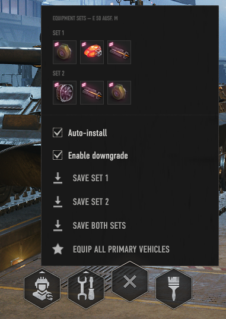

# Auto Equipment Return Mod by Z4imon

## Features
- Saves your tank equipment and automatically reinstalls it when selecting the tank
- Allows you to equip all your tanks with bounty equipment
- The equipment is pulled from depot or other tanks (only if demounting is free)
  - When several tanks hold the same device, the one you used **least recently**
    is taken from, not the one you just left. Flicking between two tanks in the
    garage therefore stops them stripping each other every time you switch.
- *Downgrade:* if activated, installs a standard equipment instead of
 the bounty or bond equipment if there is none available.
- *Equip primary vehicles:* if clicked, installs the equipment for all the (filtered)
  primary vehicles in your garage. Ideal for **Frontline**, **Onslaught** and **Onslaught light**.
  Using this, you have all your tanks for those game modes available within seconds.
  - Depending on the amount of vehicles, this takes time, this is normal!
  - After all equipments are succesfully equipped, the automatic equipment return is disabled
    to allow browsing the other tanks.
- *Equip playlist vehicles:* same batch install, but for the tanks in the current playlist.
  The carousel filter is ignored here unless you turn it on under *Feature Toggles (Behavior)*.
- *Demount equipment:* right-click a tank in the carousel to demount all equipment
  that demounts for free.
- *Demount bounty equipment:* right-click a tank in the carousel to demount only
  bounty equipment that demounts for free. Off by default, turn it on under
  *Feature Toggles (Tank Carousel Menu)*.
- *Demount improved equipment (360 China only):* right-click a tank in the
  carousel to demount only Improved (purple) equipment that demounts for free.
  Off by default, turn it on under *Feature Toggles (Tank Carousel Menu)*.
  Wargaming's WoT Plus does not free-demount Improved devices, so this row is
  not built on WG servers at all.
- *Demount all bounty equipment:* if clicked, demounts bounty equipment
  from every tank in the hangar. Off by default, turn it on under
  *Feature Toggles (Icon Menu)*. Ideal for **Frontline**, **Onslaught** and **Onslaught light**.
  Using this, your limited bounty equipment goes back to the depot. Afterwards the
  automatic equipment return is disabled, so browsing tanks does not put it straight
  back. Turn auto-install on again and select the tanks you want to prioritize
  in your upcoming session. Once a notification indicates that auto-install is
  stealing equipment from other tanks, you know that you used up all your free
  bounty equipment.
- *Demount all improved equipment (360 China only):* the garage-wide twin of the
  row above, for the realm where Plus free-demounts Improved (purple) devices.
  Same limited-inventory strategy: pull every purple device back into the depot,
  turn auto-install on again, and hand them out to the tanks you want to
  prioritize. On WG the row never appears.
- *Feature Toggles* in the ModsSettingsAPI panel:
  - **Behavior:** Changes behavior of specific mod features.
  - **Icon Menu:** Show/hide specific rows of the hangar icon menu.
  - **Tank Carousel Menu:** Show/hide specific rows of the tank carousel menu.
- Allows you to import saved equipment from kurzdor's auto equipment return (only for the same account)
  - Done automatically on the first start of the mod or later over the modsettings
- Allows you to import saved equipments from other accounts (within the mod)

## Dependencies
- **Wot Plus** or **Wot Plus Pro** subscription
- **Gameface** (https://gitlab.com/openwg/wot.gameface)
- **ModsSettingsAPI** (https://github.com/izeberg/modssettingsapi)
- **ModsListAPI** (https://github.com/wot-public-mods/mods-list)

## Ingame
The mod menu opens with the button in the vehicle menu row of the hangar, right
next to the customization button.

- **Set 1** and **Set 2** show the equipment that is currently saved for the
  selected tank.
  - Tanks without a second loadout only show Set 1
  - The bin in the bottom right corner deletes the saved equipment for the selected tank
  - The star in the top right corner allowes you to copy the recommended equipment
- **Auto-install:** turns the automatic reinstalling on vehicle selection on
  and off
- **Enable downgrade:** If turned on installs the standard equipment when the bounty or bond
  one is not available for free
- **Always select set 1:** If turned on the mod automatically switches to set 1 after the equipment was installed. Turn it off if you want every tank put back on the set it was on before
- **Save set 1** / **Save set 2** / **Save both sets:** saves the equipment
  currently mounted on the selected tank
- **Demount all bounty equipment:** takes bounty equipment off every tank
  in the hangar and leaves other equipment mounted.
- **Demount all improved equipment (360 China only):** takes Improved (purple)
  equipment off every tank in the hangar and leaves other equipment mounted.
- **Equip primary vehicles:** equips all your filtered primary vehicles.
- **Equip playlist vehicles:** equips all your filtered playlist vehicles.

**Demount equipment** is added to the right-click menu of every tank in the carousel.
It removes everything from that tank that can be demounted for free and leaves the rest mounted.

**Demount bounty equipment** is also added to the right-click menu of every tank in the carousel.
It removes only bounty equipment from that tank if it can be demounted for free and leaves the rest mounted.

**Demount improved equipment** is the 360 China counterpart of the row above: it removes only
Improved (purple) equipment that can be demounted for free and leaves the rest mounted. It does not
exist on WG servers, where Plus does not free-demount Improved devices.

## Mod Menu Settings
The ModsSettingsAPI panel lists various options that can tweak the mod.
For example:
- Feature Toggles (Behavior)
- Feature Toggles (Icon Menu)
- Feature Toggles (Tank Carousel Menu)
- Demount equipment that is not in the saved set:
  Pick the scope (all tanks with a saved set, or only primary tanks in this hangar)
  and press *Demount*. Every device that is not in the slot its saved set names
  goes back to the depot. This is mainly for downgraded equipment: when a bounty
  device could not be found, the mod fitted the standard one instead. Tanks without
  a saved set are never touched, and nothing is removed that would cost credits,
  gold or a demount kit.

## Installation
- Download the mod from the official WoT Mods webside
- Unpack the downloaded file and move both .wotmod files into the world of tanks mod folder:
   *yourWoTInstallation/mods/currentGameVersion*
- If you already have gameface and the modssettingsapi installed, only move the auto-equipment-return file into the folder

## Contributing
Want to improve the mod? Please do! Fork the repository, make your changes and
open a pull request.

Bug reports and ideas are welcome in my channel of the official WoT discord: [Z4imon's mods](https://discord.com/channels/161053416796323840/1496838335857954887)

## License
Copyright (C) 2026 Z4imon

[GPL-3.0](LICENSE) - you are free to use and modify this mod for yourself. If
you distribute it, modified or not, it has to stay under GPL-3.0 and you have
to make the source code available, keep the original copyright notice and mark
your changes.
